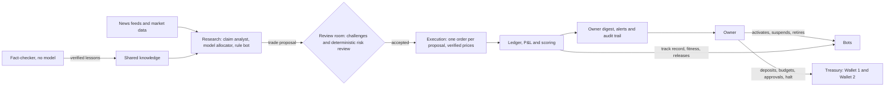

# Trading Organisation

A private organisation of cooperating AI and rule-based bots that research, propose and paper-trade eight NSE shares under the owner's control. Each bot is a member with its own identity, budget, track record and lifecycle. Independent reviewers check every proposal before it can trade, and every rupee moves through an audited double-entry ledger.

**Paper only.** All money, prices, orders and fills are simulated. `APP_MODE=live` is rejected, and no broker, bank or exchange is connected.

**Founder: start with [founderReview.md](founderReview.md).** It holds the switch-on checklist and every decision waiting for you.

**Live paper testing** started in October 2026: one rule bot trading with a ₹5,000 budget. The honest, code-checked status is the [audit of 14 October](docs/audit-2026-10-14.md), and day-by-day events are in the [project log](docs/project-log/README.md).

## How the organisation works



### Who does what

| Member | Role | What it may do |
| --- | --- | --- |
| **Owner** | The only authority over money and permissions | Deposit funds, set budgets and limits, approve releases, suspend, resume or retire bots, halt and resume the organisation, withdraw |
| **Researcher bots** | Propose and draft | Draft trade proposals and news claims, and propose lessons. They can never review their own work |
| **Evaluator bots** | Review independently | Review evidence, lessons and proposals by fixed rules. The fact-checker uses no model at all |
| **Trader bots** | Act within a budget | Execute only reviewed proposals for their own bot, within its budget and the order limit |
| **Management review** | Reviews staff daily | Applies the published `management-v1` rules to every working bot and recommends: watch, suspend, raise its budget or retire it. It never acts by itself ([management](docs/management.md)) |
| **The backend** | Enforces the rules | Roles, idempotency, the hash-chained audit trail and append-only history. No bot can change its own permissions |

Every decision waiting on the owner (recommendations, new bots, departments, releases ready to activate, bots ready to trade) is in one **owner agenda**: `npm run agenda`, then `npm run agenda -- accept <id>` or `decline <id>`.

**Agents act, the owner oversees.** With **standing approvals** (`npm run autonomy`, [autonomy](docs/autonomy.md)), the owner approves classes of decisions once, with limits:
- **What agents can then do:** suspend a flagged bot, accept small budget raises within a monthly total, approve births, activate evaluated releases, qualify bots, and give a new bot a starting budget.
- **How:** the agents carry these out every cycle, as the visible identity `autonomy-policy`.
- **Never automatic:** retirement, departments, limits, permissions and real money.

### Members working today

- **`momentum-rules`, the rule bot.** Model-free. Once a month it picks the top three shares by momentum, sells before it buys, and keeps its decision for the month. Release v2 is active with a ₹5,000 budget ([trade signals](docs/trade-signals.md#the-rule-bot-a-model-free-member)). On 10 years of history its rule is level with the basket after costs, so it is a paper experiment, not a proven edge ([R&D scout](docs/rnd-scout.md#the-10-year-result-20-october-2026)).
- **Claim analyst and fact-checker.** The analyst drafts quote-backed news claims with the local model. The independent fact-checker verifies a claim only when two independent sources report the same figure for the same period, and withdraws it if a later report disagrees ([claims](integrations/claims/README.md), [evidence claims](docs/evidence-claims.md)).
- **Model allocator.** Built and tested, not yet switched on. It needs the local model and its own forward test.
- **R&D scout.** Every cycle it screens 20 strategy ideas on 10 years of history, against the basket, net of costs and corrected for the number of ideas tried. Every idea also faces lookahead and warm-up checks, full statistics, 100 random pickers and walk-forward validation. It proposes a new specialist only for an idea that passes; none does yet ([R&D scout](docs/rnd-scout.md), [research methods](docs/research-methods.md)). A NIFTY 50 research screen (never traded) widens the search.
- **World news desk.** Central banks, regulators and publishers in India, the US, Europe, the UK and China are in a catalogue, which the owner enables source by source. Each day's items are grouped into stories across countries and linked to the shares through reviewed world drivers, and every link is tested against later moves ([world news](docs/world-news.md)).
- **Market regime.** Distribution days, breadth and trend of the eight shares give an advisory exposure ceiling. On 10 years it warns of falls but does not time them ([market regime](docs/market-regime.md)).
- **Scenario panel.** Built; it needs the model. Five personas rehearse the day's biggest linked world stories in shadow, and are scored per persona ([scenario panel](docs/scenario-panel.md)).
- **Knowledge and playbook.** Method cards (what each method is, how we test it, what our data said), a live knowledge file refreshed every cycle and fed to the model agents, and a problem playbook that gives every failing step its cause, safe fix and decider ([research methods](docs/research-methods.md#knowledge-the-agents-use)).
- **Management review.** Every cycle it reviews each working bot and files recommendations for the owner agenda ([management](docs/management.md)).
- **TradingAgents member.** Built; it needs the model and an approved install. The open-source TradingAgents firm (analysts, debate, trader, risk team, portfolio manager) is reused as one governed bot. It decides weekly, proposes in shadow until it has earned a release on its own scored calls, and then trades under the same rules as everyone ([TradingAgents member](integrations/tradingagents/README.md)).
- **Debate desk.** Built; it needs the model and a one-time `scripts/debate-setup.mjs`. A bull and a bear researcher argue every proposal before review, citing only verified evidence, and are scored on whether they were right.
- **Reflections.** Every scored call becomes a verified factual lesson for its bot: what it did, the share's move, the basket's move and the alpha. So each bot remembers its own results ([reference review](docs/reference-review-2026-10-20.md)).

### A bot's life

The owner's idea is *birth, education, livelihood, evolution and retirement*, as software lifecycle rules (not consciousness):

1. **Birth:** a new identity, admitted only for a distinct opportunity, not as a renamed copy.
2. **School and college:** reviewed lessons, then measured exams.
3. **Paper trading:** qualified bots trade through releases, with live fitness measured against holding cash.
4. **Reputation:** good results earn responsibility, and poor results lead to suspension, a smaller budget or retirement.
5. **Retirement:** what the bot learned is kept for the organisation, and its history is never deleted.

Departments, hackathons, births and compute budgets have tested backend rules, but the daily cycle does not use them yet ([audit](docs/audit-2026-10-14.md)).

### The money rules

1. **Deposits:** every owner deposit goes into Wallet 1. Wallet 2 starts at zero.
2. **Profit split:** only newly verified cumulative realised net profit, after losses and costs, is split: 60% stays in Wallet 1 and 40% is protected in Wallet 2. Losses must be recovered before the next split.
3. **Bot limits:** bots can never spend Wallet 2, withdraw to the bank, change the split or raise their own limits.
4. **Owner transfers:** the owner moves money between the wallets or withdraws with signed, expiring authorisation, all recorded in the ledger.

All amounts are integer paise in balanced double-entry journals ([financial model](docs/financial-model.md), [wallet rules](docs/knowledge-base/12-wallet-and-treasury.md)).

## The daily cycle

`npm run cycle`, run after 16:00 IST, does the day's work in a fixed order. Steps that need the local model are skipped when it is not running, and the rest still run.

| Stage | Steps |
| --- | --- |
| Check | Health, then market-data refresh (settled bars only; moves over 20% wait for the owner's confirmation), then the market regime and its study |
| Learn | News feeds, relevance triage (`scope-v2`, world terms), world stories and the link study, the scenario panel (needs the model) and its scoring, claims and fact-check (needs the model), learning workflows (needs the model), then chain links |
| Test | Forward tests |
| Academy | Exams, remediation, lifecycle (school to college, reputation, retirement requests), research dispatch, experiments and reviewed memory. Each does nothing until you enable its policy |
| Research | The R&D scout's screen of strategy ideas, then the live knowledge refresh |
| Propose | Rule bot, then R&D-born bots (onboarded and gated by their release), then the model allocator (needs the model) |
| Trade | Review at the verified close, fill at the next verified open (at most 1% of that session's volume), then score signals and live fitness |
| Manage | After the paper snapshot: the management review of every working bot, then the agents carry out what the standing approvals cover |
| Report | Paper snapshot, then alerts, then the owner digest |

The daily routine and recovery steps are in the [live testing runbook](docs/live-testing.md). A failed or degraded step is matched to the problem playbook, so the console, the journal, the escalation and the morning readiness check say the cause, the safe fix and who decides.

## Status

| Area | Status |
| --- | --- |
| Ledger, wallets, paper P&L, audit chain | Done and tested |
| Proposals, review, execution, scoring, releases, fitness | Done and tested for daily trading |
| Prices, marks, splits, bonuses and dividends | Done and tested (corporate actions are recorded by the owner) |
| Daily cycle, readiness check, digest, alerts, backup | Done and tested. There is no built-in schedule, and alerts go to a local outbox for now |
| Rule bot | Live in paper testing |
| News feeds, triage and automatic fact-checking | Done. Drafting claims needs the local model |
| World news catalogue, stories, world drivers and link study | Done. World sources stay off until the owner enables them |
| Market regime, research checks, NIFTY 50 research screen, knowledge and playbook | Done and run on 10 years of history |
| Scenario panel, debate desk, TradingAgents | Built and tested, waiting for the model |
| Model allocator, learning loop | Built and tested, waiting for the model |
| Departments, births, hackathons, compute budgets | Backend rules tested, not used by the cycle yet |
| Intraday monitor (mark-to-market, warnings, crash brake) | Done and tested on 38 replayed days; a live feed adapter waits for the owner's broker choice |
| Autonomy rehearsal, starter policy, supervisor catch-up and heartbeat, Saturday preflight | Done and tested: 8 rounds of the real trading path under standing approvals, with injected failures; every invariant held |
| Model evaluation suite and training data | Done: all six model tasks tested with their real prompts. The 4B model is 100% valid and safe, but sensitive to wording. Production calls are journaled and labelled for a future fine-tune |
| Source-code review of 13 reference projects | Done: [research notes](docs/research-notes/README.md) with a ranked gap analysis; defects found in our scout were fixed |
| Live money, intraday trading | Not built (paper only, by design) |

**Still needs the owner:** everything is listed, in order, in [founderReview.md](founderReview.md). It covers the
switch-on (backup, start, starter policy, model, members, supervisor, alerts, holidays, world sources) and 23 decisions,
on money, research, the model, data approvals, real-time testing, the frontend and the repository.

## Run locally

Use Node.js 24 and Python 3.12 or 3.13, from this project directory, in Command Prompt. The database is persistent PGlite in `.data/paper`, so Docker is not needed.

```cmd
npm ci --ignore-scripts
npm run dev:setup
npm run build
npm start
```

`dev:setup` creates development credentials and an Ed25519 owner signing key in ignored local files. Run it once for a new checkout; it refuses to overwrite an existing `.env`. Keep `.env`, `.local` and `.data` private, and do not expose the server to the internet.

**Daily live routine,** in a second terminal (open a fresh one, so old environment variables cannot override `.env`):

```cmd
npm run readiness
npm run cycle
```

- **When:** run `readiness` before 09:15 IST for a go/no-go, and `cycle` after 16:00 IST.
- **Backup:** `npm run backup` takes a backup before any change to the live setup.
- **Rule bot:** the owner activates it with `npm run rulebot -- plan`, then `credential --yes`, then `apply --yes`.
- **Local model:** `npm run model:local` serves Qwen3.5-4B on loopback for the model steps.

**Synthetic demo:** `npm run demo` runs the whole journey on a fresh database: evidence, a new bot, school, research, independent evaluation, paper trades and the 60/40 split.

## Tests

```cmd
npm run verify
```

This runs every suite and writes logs to `.local/verify/`:
- backend;
- scripts;
- trading desk;
- quant advisor;
- claims;
- integration tests;
- Hermes;
- market replay;
- skfolio.

GitHub runs the same gate on every push to `dev` or `main` and on pull requests (`.github/workflows/verify.yml`, Windows runner, no secrets needed).

In the full run on 20 October 2026, 636 of 637 tests passed. The one failure was a timing flake in a test; after the fix that suite passed on its own ([verification](docs/verification.md)).

## Read more

| Read | For |
| --- | --- |
| [KT.md](KT.md) | Knowledge transfer: state, decisions and pitfalls. Start here to continue the work |
| [Audit of 14 October](docs/audit-2026-10-14.md) | Honest status of every planned idea |
| [Live testing runbook](docs/live-testing.md) | Daily operation |
| [Project log](docs/project-log/README.md) | What happened each day |
| [Trade signals](docs/trade-signals.md), [bot control](docs/bot-control.md), [releases](docs/releases.md) | Proposals, review, owner controls and release management |
| [Paper performance](docs/paper-performance.md), [corporate actions](docs/corporate-actions.md) | P&L, the basket benchmark, splits and dividends |
| [R&D scout](docs/rnd-scout.md), [research methods](docs/research-methods.md), [market regime](docs/market-regime.md) | How ideas are tested, what 10 years said, the knowledge base and the problem playbook |
| [Roadmap to proven skill](docs/skill-roadmap.md) | Why skill cannot be proven on 8 shares (proof time, tax) and the plan: a broad point-in-time universe, slower tax-aware rules, better data |
| [World news](docs/world-news.md), [scenario panel](docs/scenario-panel.md) | Sources by country, stories, world drivers and the persona panel |
| [Intraday monitor](docs/intraday-monitor.md) | Real-time testing: live mark-to-market, crash brake, replay of recorded days; what a live feed still needs |
| [Founder review](founderReview.md) | Everything that needs the founder: the switch-on checklist and every pending decision |
| [Research notes and gap analysis](docs/research-notes/README.md) | How 13 reference projects really work (from their source code), where we are ahead, and our ranked gaps |
| [Model evaluation](docs/model-eval.md), [autonomy](docs/autonomy.md) | The model's measured reliability; standing approvals, the starter policy and the autonomy rehearsal |
| [Vision and principles](docs/knowledge-base/01-vision-and-principles.md), [bot lifecycle](docs/knowledge-base/11-research-development-and-bot-lifecycle.md) | The organisation we are building |
| [Architecture](docs/architecture.md), [API](docs/api.md), [security](docs/security-and-operations.md) | Services, roles and authority boundaries |
| [Documentation index](docs/documentation-index.md) | Every document, including the dated version history |

## Source ownership and independence

The core owns:
- identities and capital;
- audit records and learning evidence;
- qualification and job state.

Hermes, Ruflo and skfolio are optional, version-pinned integrations with no authority over those rules. The other reference projects are architectural references ([reference map](docs/reference-map.md)). Version pins, licences and lockfiles are kept, so a retained deployment does not stop if an upstream repository disappears. Credentials, databases and installed dependencies are never committed.
