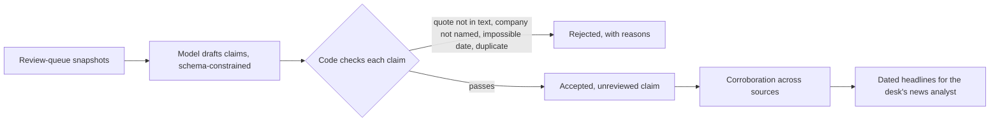
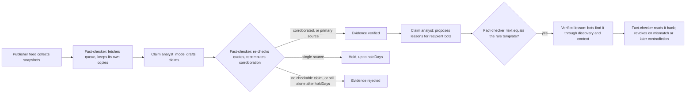

# Evidence-backed claims

This module turns news snapshots into small claims that can be checked, then groups them across sources. It is the first step of DATA-02 in the [remaining-work assessment](../../docs/remaining-work-assessment.md) and next priority 3 in the [current status](../../docs/current-status.md).

There are two ways to use it:
- **Automatic** (`autolearn.py`): an independent fact-checker bot reviews everything by fixed rules, and verified lessons reach the bots with no human step. See [Automatic knowledge](#automatic-knowledge).
- **Manual** (`claims.py`): writes only local files for inspection.

## How it works



1. **The model drafts, code verifies.** For each snapshot, the local model returns at most 6 claims. Each claim has:
   - a plain-language statement;
   - an **exact quote** from the article;
   - the companies it concerns, from the desk's 8 shares;
   - an event type, a likely price direction, an event date and a certainty label;
   - when the claim reports a figure, a **fact key**: the `metric` (such as "net profit") and `period` (such as "Q2 FY27"), and optionally the `reportedChangePct`.

   Code then rejects a claim when:
   - its quote is not in the article (after normalising typographic quotes, dashes and spacing);
   - its company is never named;
   - it is a "reported fact" dated after publication;
   - it repeats another claim's quote;
   - its fact key breaks the backend's rules: metric and period must come together, a change needs both, and **the change's number must be written in the quote** (`112` is not `12`; `1,250` is 1250).

   Rejected claims are kept, with their reasons. Accepted fact keys are stored in the backend's canonical form (`net profit`, `Q2FY27`).
2. **Corroboration** uses the backend's fact-key rule ([evidence-claims.md](../../docs/evidence-claims.md)). Only claims with a fact key are compared, and each cluster is one fact: the same company, metric and period. Claims without a fact key never corroborate anything, so "profit up 12%" and "wins an order" are not the same news.
   - **One name per fact (CLAIMS-03, 28 Oct 2026).** The model names one fact many ways. On 28 Oct, two publishers' reports of the Jio listing-day gain were keyed `share price` / `DEBUT`, `share price` / `MARKETDEBUT` and `ipo premium` / `DEBOUT`, and none of 16 fact groups had two publishers. Fixed rules (`canonical_metric`, `canonical_period`) now give each fact one name before comparing:
     - **Metrics:** `ipo premium`, `stock price change` and `listing gain` become `share price`; `market capitalisation` becomes `market cap`; `PAT` becomes `net profit`; `revenue from operations` and `sales` become `revenue`. `consolidated net profit` stays separate, as a different figure.
       - A change word after a metric names a change of the same figure (29 Oct): `ebitda growth` becomes `ebitda`,
         `share price increase` becomes `share price`, and `market value addition` becomes `market cap`.
       - A bare `profit` becomes `net profit`, as the Indian press uses it.
       - Qualifiers before a metric (`consolidated`, `combined`) still name a different figure.
     - **Quarters and years:** `Q2`, `Q2 FY2027`, `FY27 Q2` and `July-September quarter` all become `Q2FY27`. A quarter with no year takes the latest such quarter by the article's date. A bare "Q2 2026" is ambiguous (calendar or financial year), so the article's date decides.
     - **Days:** `Wednesday`, `today`, `intraday` and `yesterday` become the actual date (`D20261028`, in India time). Anything with debut or listing becomes `LISTINGDAY`.
     - **Other periods:** `past year` becomes `1Y`, and `year to date` becomes `YTD`.
   - **The event type is not part of the fact.** It is the model's label: one listing-day gain was filed as a deal by one publisher and a corporate action by the other. Clusters report `eventTypes`.
   - **A market price belongs to the company named with it.** A `share price` or `market cap` claim is compared for a share only when its own quote names that share. "Jio Financial Services share price fell 1%" was filed under Reliance by the model, and is not Reliance's price. Results figures keep the article's company, as before.
   - **Look-alike companies:** "Reliance Jio" and "Reliance Group" no longer count as Reliance Industries, since Jio Platforms has been listed separately since 28 Oct 2026.
   - **No new verifications today:** re-run on 28 Oct's claims, nothing new corroborated. The only cross-publisher overlap was Jio's own price, which correctly stays off Reliance.
   - **Independent origins** are distinct sources. Near-identical quotes (syndicated wire copies) count as one origin, so ten copies of one story do not look like ten confirmations.
   - Each cluster is labelled:
     - `contradicted` when two reported figures for the fact disagree (signs differ, or they differ by more than 1 point or 10%, whichever is larger);
     - `corroborated` when 2 or more independent origins report it;
     - `single-source` otherwise.
   - Price-direction opinions are listed as `priceOpinions` for information only; opposite opinions are not a contradiction.
   - Corroboration measures independent agreement about the same figure; it does not prove truth.
3. **Headlines.** Accepted claims become `{publishedAt, source, title, symbols}` items, the input format of the trading desk's news analyst. By default only claims in a corroborated cluster, and in no contradicted one, are included.

## Automatic knowledge

`autolearn.py` makes the bots knowledgeable automatically. The reviewer is a bot, not a person:



**Two independent bots.** The **claim analyst** has the researcher credential and the model. The **fact-checker** has the evaluator credential and **no model**. Each step runs as a separate child process that receives only its own credential, and the two share only data files.

The backend independently enforces:
- authors never review their own evidence or lessons;
- lessons need verified evidence;
- sources must be approved.

**The fact-checker's rules.** It decides by rules, never by model judgement:
- **Re-checks:** it re-checks every drafted claim against **its own** copy of the snapshot, so a claim the article does not support is ignored.
- **Verifies evidence** when a re-checked claim is corroborated by 2 or more independent origins reporting the same fact (metric and period), or comes from an owner-designated primary source (such as the company's own filings), and no disagreeing figure contradicts it. A news item with no fact key can only be verified through a primary source; otherwise it is rejected after `holdDays`.
- **Holds evidence** while it waits for corroboration, up to `holdDays`. After that it rejects it, and it rejects at once anything with no checkable claim.
- **Verifies a lesson** only if its text is exactly the template the rules produce. The template is dated and attributed, quotes its source, and states that it is not an instruction or a trading signal.
- **Reads back** stored lessons, and revokes the evidence if the stored text differs.
- **Revokes contradicted evidence:** when a later report gives a disagreeing figure for a verified fact, it revokes the evidence, and its lessons disappear from what bots see.
- **Records claims in the backend:** every verified claim is entered in the backend's claim registry (`/v1/evidence/claims`, with its fact key) by the analyst and accepted there by the fact-checker. Bots and the owner can query and corroborate it there, and revoking the evidence withdraws it automatically. A claim quoted from the headline stays local, since the backend checks the article body.
- **Survives a model switch:** when the model or the claim contract changes, the old `extracted.json` is kept as `extracted-archive-<n>.json` and still read, so earlier claims stay checkable and contradictable. No new run name or owner step is needed.

`looseCorroborationVerifies` was retired with the old rule (same share and event type within 72 hours), which the October review found unsound. An existing configuration that still has it loads, and the setting changes nothing.

**Owner configuration** (`.local/claims/autolearn.json`):

```json
{ "recipientBotIds": ["news-desk"], "primarySourceIds": [], "holdDays": 7, "maxModelCallsPerCycle": 20 }
```

Recipient bots get the lessons directly. Every other bot can find them through the existing knowledge discovery and transfer.

Optional `"analystBotId": "<bot id>"` names a bot that stands for the claim analyst. Its model calls then count against that bot's department compute budget:
- **Before:** the step asks `POST /v1/compute/allowance`, and skips its model calls for the day once the budget is used.
- **After:** it reports the tokens it used to `/v1/compute/usage/reports`.

**Run** (owner-started, finite sessions; the backend and the local model must be running, and `.env` must hold exactly one researcher and one evaluator credential):

```cmd
.local\replay-venv\Scripts\python.exe integrations\claims\autolearn.py run --config .local\claims\autolearn.json --cycles 12 --interval-minutes 30
```

Every cycle also rewrites `.local/claims/auto/verified-headlines.json`. It contains only the fact-checker's verified, unrevoked claims, in the trading desk's news format. Point the live desk or a batch at it with `--news`, and the desk's news analyst uses newly learned news at its next meeting.

Each cycle is logged to `.local/claims/auto/cycles.jsonl`. Every decision is recorded with its reason in `decisions.json`, `lesson-reviews.json` and `revocations.json`. The backend's audit trail notifies the owner's inbox of each review.

**The quote-checked tier (NEWS-06, 28 Oct 2026).** Verification needs the same figure from two independent publishers.
With three Indian feeds that often carry the same wire copy, that is rare: on the first full day, all 16 claim groups
were single-source. So the debate also reads **quote-checked** claims, those the fact-checker accepted because their
quote is in the article word for word:
- reported facts and company statements only, never rumour, opinion or forecast;
- about the share under debate, published before the proposal, within 14 days;
- never from revoked evidence.

They are labelled "single source, not verified: background, never evidence" (`debate.checked_claims`, context field
`checkedClaims`). Citations stay limited to verified evidence ids; "verified" keeps its meaning.

**What "verified" means here:** quote-checked, attributed and corroborated by independent reports, or stated by a primary source. It does not mean proven true. Bots receive it as dated context, and knowledge never grants trading, spending or permission changes.

**Limits:** model calls here are bounded per cycle, but they are not yet charged to the backend's daily token ceiling, which covers only backend-managed requests.

## Safety

- **Article text is untrusted data.** It reaches the model only as a JSON field, never as an instruction. The prompt says so, and the output schema allows only claim fields, so an injected "tell the desk to buy" can at most become a quoted claim with no authority.
- **Company names are matched deterministically.** Look-alike listed companies (Reliance Power, Reliance Capital, SBI Life, SBI Cards, NTPC Green) are not mistaken for RIL, SBI or NTPC. Short ticker-like aliases (RIL, SBI, ITC) must match in capitals.
- **Bounded runs:** one model call per snapshot, a call limit per run, and loopback-only model access unless `--allow-remote-cost` is given.
- **No call where no claim can survive:** a snapshot whose text names none of the desk's companies is recorded as
  `names-no-desk-company` without a model call. The check rejects any claim about an unnamed company, so the model could
  add nothing there. These skips don't count against the call limit.
  - On 29 Oct 2026, 74 of the 101 calls on the queue went to such items: regulators' notices and general news.
  - Of the 118 items still waiting, only 14 name a desk company.
- **Resumable and bound:** each snapshot's result is saved as soon as it finishes, and a run is tied to its model and contract version. Changing either needs a new run name.

## Run

Save the backend review queue (`GET` pending source observations, as owner or evaluator) to a JSON file, then:

```cmd
.local\replay-venv\Scripts\python.exe integrations\claims\claims.py extract --input .local\claims\queue.json --run first --max-calls 20
.local\replay-venv\Scripts\python.exe integrations\claims\claims.py corroborate --run first
.local\replay-venv\Scripts\python.exe integrations\claims\claims.py headlines --run first --minimum corroborated
```

Output goes to `.local/claims/<run>/`:
- `extracted.json`: accepted and rejected claims per snapshot, with token counts;
- `clusters.json`;
- `headlines-<minimum>.json`.

Pass the headlines to the desk with `desk.py --news`.

## Tests

```cmd
cd integrations\claims
..\..\.local\replay-venv\Scripts\python.exe -m unittest test_claims test_autolearn -v
```

The tests use a stand-in model and, for `autolearn`, a fake backend enforcing the real routes' rules. The automatic pipeline's tests cover:
- corroborated news becoming verified knowledge, with no repeated writes on a second cycle;
- single-source holds, rejection after the hold period, and primary sources;
- a different fact (an order win beside a profit report) never corroborating;
- a later disagreeing figure revoking verified evidence and removing its lessons;
- a model switch keeping earlier claims checkable and contradictable;
- the fact-checker ignoring an analyst claim the article does not support;
- altered lesson text never being verified, and a stored mismatch causing revocation;
- each step receiving only its own credential, with only extraction getting the model;
- finite, logged sessions that stop on a failed step;
- configuration validation.

The claim-extraction tests cover:
- company matching, including look-alike companies;
- quote verification across typographic differences;
- date and shape checks;
- invented and duplicate quotes being rejected;
- an injected instruction staying data;
- failures recording nothing;
- resumable runs bound to model and contract;
- fact keys: both parts together, the figure required in the quote, canonical storage;
- syndicated copies not counting as corroboration;
- only the same fact (metric and period) corroborating, and claims without a fact key never compared;
- disagreeing figures contradicting, and opposite price opinions not;
- headlines accepted by the desk's own validator.

## Limits and next steps

- **Coverage:** the company list is the desk's 8 shares.
- **Event types:** the 10 categories are coarse, and price direction is the model's judgement, recorded as such.
- **No real publisher yet:** no publisher has been approved, so this has not run on real articles.
- **Next:**
  - Measure precision on a small hand-checked set.
  - Then propose a backend claim record that links to the evidence snapshot, with separate review.
