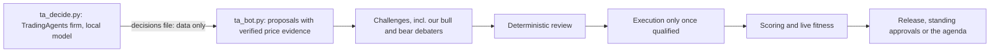

# TradingAgents as a governed member

[TradingAgents](https://github.com/TauricResearch/TradingAgents) (Tauric Research, Apache-2.0) is an open-source multi-agent trading firm:
- market, news and fundamentals analysts;
- bull and bear researchers in debate;
- a trader, a risk team, and a portfolio manager who issues a five-tier rating.

We **reuse it as it is**, as one member of our organisation, instead of rebuilding it. It brings its analysis; our organisation brings the governance it doesn't have:

| TradingAgents decides | Our organisation decides |
| --- | --- |
| A rating per share (Buy, Overweight, Hold, Underweight, Sell) with its reasoning | Whether it may trade at all, how much, when it's executed, how it's scored, and whether it keeps its place |

## How it fits



- **Two processes:**
  - `ta_decide.py` runs in TradingAgents' own environment. It has no credential and only writes `.local/tradingagents/decisions/<day>.json`.
  - `ta_bot.py` runs in our environment, as the bot `TA_BOT_ID` with its own trader credential.
- **Ratings become proposals:**

  | Rating | Proposal |
  | --- | --- |
  | Buy | Long, high conviction, 25% target |
  | Overweight | Long, medium conviction, 15% |
  | Underweight or Sell | Exit (a directional call, scored like any) |
  | Hold | Nothing |

  An unclear or failed rating produces nothing: it is recorded, never guessed.
- **Evidence is data, opinion is labelled:** each proposal cites verified closes for the decided session. TradingAgents' reasoning goes in the thesis, labelled as the model's opinion.
- **It earns its place:**
  1. **Shadow:** with no release, the bot proposes while in school with zero budget. The review rejects the trade but prices it, and the scorer scores it.
  2. **Evaluate:** after 20 scored shadow calls, `ta_bot.py onboard` has the researcher register its release (engine version, model, settings, code fingerprint). The evaluator then evaluates the release on that live shadow record.
  3. **Trade:** standing approvals or the agenda activate, qualify and fund it. From then on it trades only while `POST /v1/releases/check` allows its exact identity, and live fitness can promote or roll it back like any member.
- **Cost:** about a dozen model calls per share per decision. On the local 4B model, that is hours for all 8 shares. So it decides **once a week, on Fridays** (cycle `--with-model`). Its step checks the compute allowance first, and a share that fails is retried on the next run.

## Install (owner-approved download)

It needs Python 3.11 or newer, in its own environment:

```cmd
python -m venv .local\tradingagents-venv
.local\tradingagents-venv\Scripts\python.exe -m pip install -r integrations\tradingagents\requirements.txt
```

Then set it up as a member:
1. **Create the bot** (owner), with zero budget: `POST /v1/bots` with `{ id: "tradingagents", department: "desk", specialty: "multi-agent-research", method: "tradingagents", budgetPaise: "0" }`.
2. **Give it a credential:** `npm run bot-credential -- --bot tradingagents --yes`.
3. **Name it:** set `TA_BOT_ID=tradingagents` in `.env`, then restart the backend.

TradingAgents fetches its own market data, news and fundamentals from Yahoo Finance and SEC EDGAR. It needs no API key, but it does need the internet when it decides. Its own logs, cache and memory stay under `.local/tradingagents/`.

## Tests

`integrations/tradingagents/test_tradingagents.py` uses a stand-in engine, so the real package is never needed to test the governance. It covers:
- strict rating parsing, and failures recorded rather than guessed;
- resumable decisions;
- shadow proposals with verified price evidence, once per decided day;
- the release gate;
- staleness;
- earning a release only after 20 scored shadow calls.

`backend/test/shadow-fitness.test.ts` covers the backend half: unqualified calls are priced, scored and judged by model, and the first release is evaluated on them.
